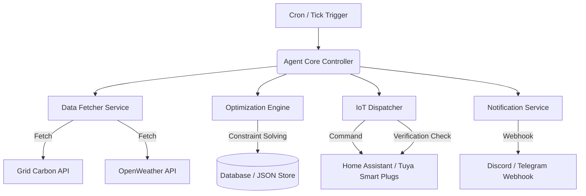

# Technical Implementation Plan

## Project: EcoRoute — Smart-Grid Energy Optimizer Agent

---

## 1. System Architecture
EcoRoute is structured as a modular TypeScript/Node.js or Python-based service running an event-driven agent loop. The agent periodically queries external data sources, updates a local schedule, and dispatches actions to IoT APIs.



---

## 2. Directory Structure
```text
ecoroute/
├── config/
│   └── default.json          # Configuration parameters
├── src/
│   ├── index.ts              # Entry point & Agent Loop
│   ├── services/
│   │   ├── grid.ts           # Grid Intensity & Pricing API connector
│   │   ├── weather.ts        # Weather API connector
│   │   ├── iot.ts            # Home Assistant / Smart Plug connector
│   │   └── notifier.ts       # Telegram / Discord notifier
│   ├── engine/
│   │   └── optimizer.ts      # Scheduling and optimization logic
│   └── utils/
│       ├── logger.ts         # Centralized logger
│       └── db.ts             # Local database (SQLite or Lowdb)
├── tests/
│   └── optimizer.test.ts     # Core engine unit tests
├── .env.example              # Environment variables template
├── package.json
└── README.md
```

---

## 3. Data Integration & APIs

### 3.1 Grid Intensity & Pricing
*   **API:** National Grid Carbon Intensity API (UK)
*   **Protocol:** HTTPS GET JSON
*   **Sample Endpoint:** `https://api.carbonintensity.org.uk/intensity`
*   **Key Fields:** `forecast`, `actual`, `index` (very low, low, moderate, high, very high).

### 3.2 Weather Data
*   **API:** OpenWeatherMap API
*   **Protocol:** HTTPS GET JSON
*   **Endpoint:** `https://api.openweathermap.org/data/2.5/forecast`
*   **Key Fields:** `temp`, `clouds`, `wind`.

### 3.3 IoT Integrations
*   **API:** Home Assistant REST API
*   **Protocol:** HTTPS POST with Bearer Token
*   **Endpoint:** `http://<ha-ip>:8123/api/services/switch/turn_on`
*   **Payload:** `{"entity_id": "switch.ev_charger_plug"}`

---

## 4. Scheduling & Optimization Algorithm
The engine solves a simple constrained optimization problem hourly. 

**Inputs:**
- Target runtime requirement $D$ (duration in hours).
- Target completion deadline $T_{deadline}$ (timestamp).
- Array of 30-minute intervals $I$ from now until $T_{deadline}$.
- Grid intensity forecast $C(t)$ for each interval $t \in I$.
- Tariff pricing $P(t)$ for each interval $t \in I$.

**Objective Function:**
$$\min \sum_{t \in S} (w_1 \cdot C(t) + w_2 \cdot P(t))$$
Where:
- $S \subset I$ is the set of chosen run intervals of size $D \times 2$.
- $w_1, w_2$ are weights configured by the user (carbon vs. cost preference).

---

## 5. Verification Plan

### Automated Verification
- **Unit Tests:** Execute mocks of `grid.ts` and `weather.ts` output to verify `optimizer.ts` produces the correct lowest-cost slots.
- **Dry-run Mode:** Flag in CLI to run optimization and log HTTP requests without sending actual commands to IoT plugs.

### Manual Verification
1. Run target script on a test runner with a virtual switch entity in Home Assistant.
2. Confirm the state of the switch changes on screen.
3. Verify that the Discord notification contains the correct state parameters.
